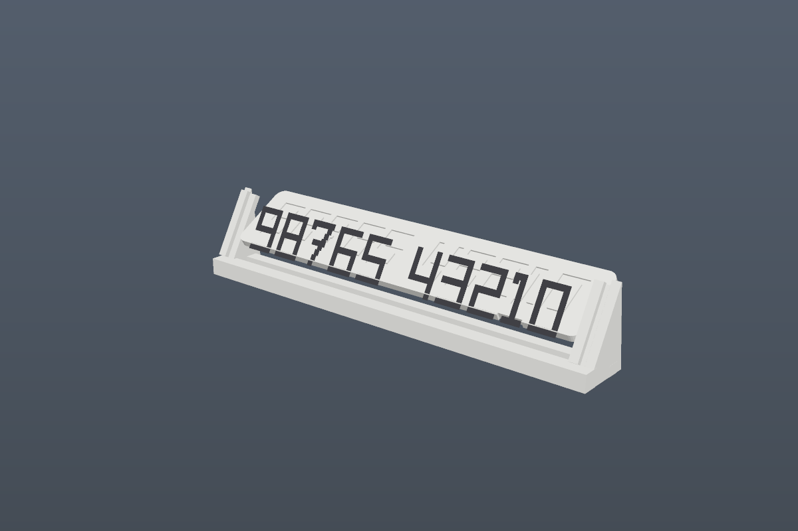
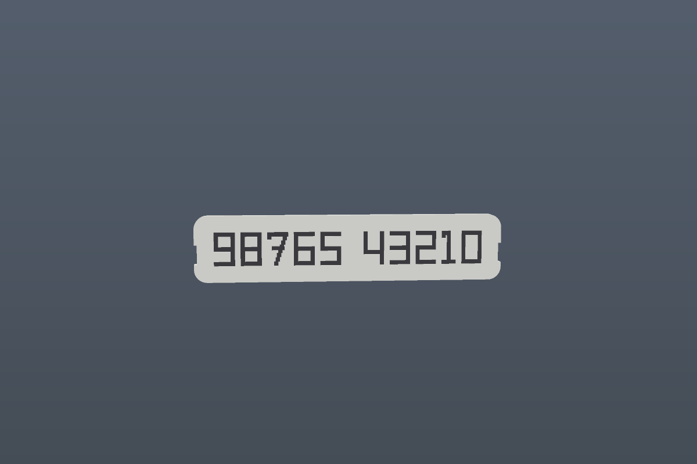
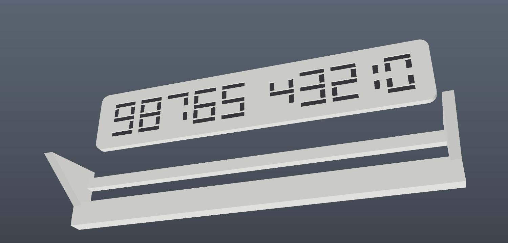

# Plate Forge

A parametric generator for a single-colour, single-sided car parking number plate: a flat engraved
panel that drops into a reusable 30° easel. Sized for a **Bambu Lab A1 mini**.



Three ways in: a **browser generator** that exports STLs, an **OpenSCAD file** ready for MakerWorld's
Parametric Model Maker, and this repo's geometry tests.

## Why this shape

- **Engraved, not raised.** A 0.6 mm groove has a rim that acts as a paint dam and a floor the slicer
  can iron flat, so a pen fills it cleanly and wipes clean off the face.
- **Flat panel + separate easel.** The panel prints face up, flat on the bed, with no supports. The
  easel prints once. Changing the number costs one 15-minute panel rather than a whole new plate.
- **Watertight by construction.** The panel is a single closed manifold surface, not two solids
  stacked. A slicer reads an interface sitting exactly on the groove floor as a filled cavity and
  silently swallows the digits; the test suite checks every edge is shared by exactly two triangles.



## The browser generator

1. Type the number. Only digits, space, `+`, `-`, `.` are accepted.
2. Pick **Engraved** (recommended) or **Raised**.
3. The HUD warns if the job no longer fits the 180 mm bed; the digit height shrinks automatically.
4. **Download** the panel, the easel, both on one plate, or the pen test coupon.

Live at **https://tumesh007.github.io/plate-forge/**, or open `index.html` from any static server.
No build step, no CDN, no accounts — the geometry and the STL export all happen in the page.

The URL carries your settings, so a configuration can be bookmarked.

## The OpenSCAD file

`openscad/plate_forge.scad` is the same model written for MakerWorld's Parametric Model Maker:

| | |
|---|---|
| Parameters | Customizer-style, with dropdowns for mode and lettering |
| Output | `mw_plate_1()` for the printable plate, `mw_assembly_view()` for the preview |
| Dependencies | none — no BOSL2, no font packs, no external includes |
| Renders in | ~2.5 s for the default job |

Test it with:

```sh
openscad --export-format binstl -o out.stl openscad/plate_forge.scad
openscad --export-format binstl -o easel.stl -D 'mode="easel"' openscad/plate_forge.scad
```

Generated volumes match the browser model to within 1.5 % (panel 13.6 cm³, easel 17.4 cm³).

## Printing

Short version: 0.20 mm layers, 4 walls, 5 top / 4 bottom, 15 % gyroid, elephant-foot compensation
0.15 mm, and **ironing set to "All top surfaces"** — not "Only topmost", which irons the rim and
skips every digit. Full recipe in [PRINT-SETTINGS.md](PRINT-SETTINGS.md).

Print the **pen test coupon** first. Eight minutes, six combinations, and it turns the advice into a
measurement on your own filament.



## Files

| Path | |
|---|---|
| `index.html`, `css/`, `js/` | the browser generator |
| `js/model.js` | panel, easel, coupon geometry |
| `js/glyphs.js` | 7-segment glyph layout |
| `js/stl.js` | binary STL writer, print-space transform |
| `openscad/plate_forge.scad` | **the parametric model, MakerWorld ready** |
| `vendor/three.module.js` | three.js r169, vendored so the site has no CDN dependency |
| `test/check.mjs` | headless geometry tests — manifoldness, volume, bed fit |
| `test/render.mjs`, `test/render-scad.mjs`, `test/raster.mjs` | offline rasteriser, writes `docs/` |
| `make_doc.py` | builds `Plate-Forge-Documentation.docx` |
| `OPTIONS.md` | **the research: what the alternatives are and why this one won** |
| `PRINT-SETTINGS.md` | exact slicer settings and the ink workflow |
| `MAKERWORLD.md` | listing copy, tags and settings for the upload |
| `Plate-Forge-Documentation.docx` / `.pdf` | the whole thing as one document |

## Tests

```sh
node test/check.mjs    # manifold + volume + fit checks over 12 configurations
```

The check script asserts every triangle edge is shared by exactly two triangles, that volume is
positive and finite, that there are no NaN vertices, and that the panel sits on `z = 0` in printer
space. `test/render.mjs` and `test/render-scad.mjs` write PPM previews; they need a `three` shim at
`../node_modules/three` pointing at `vendor/three.module.js`.

## Deploying

Static site, `index.html` at the repo root, no build step:

```sh
gh api -X POST repos/:owner/plate-forge/pages -f 'source[branch]=main' -f 'source[path]=/'
```

`.nojekyll` is present so nothing is preprocessed.

## Notes

- Everything is millimetres. The viewport is Y-up; exported STL is Z-up, sitting on `z = 0`.
- The panel is capped at 166 mm wide so the easel still clears the bed.
- Mass and print-time readouts are estimates from solid volume with a shelling factor, not slicer
  output. Trust them to within ~25 %.
